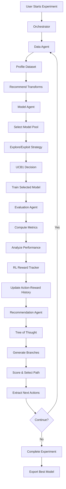

# 🚀 Model Autopilot

> **AI-Driven Machine Learning Optimization Platform**

Model Autopilot is an advanced ML platform that uses **LLM-powered agents** with **Tree of Thought reasoning** to automatically optimize machine learning models. It combines explore-exploit strategies, feature engineering, and reinforcement learning to find the best model configurations for your data.

[](LICENSE)
[](https://www.python.org/downloads/)
[](https://fastapi.tiangolo.com/)
[](https://reactjs.org/)

---

## ✨ Key Features

### 🤖 LLM-Powered Agents
- **4 Specialized Agents**: Data, Model, Evaluation, and Recommendation agents
- **Tree of Thought Reasoning**: Multi-branch strategy exploration with scoring
- **Adaptive Decision Making**: Learns from previous iterations using RL rewards

### 🎯 Advanced Optimization
- **24 ML Models**: Scikit-learn, XGBoost, LightGBM support
- **Explore-Exploit Strategy**: UCB1 algorithm with configurable epsilon
- **Multi-Objective Optimization**: Pareto front and weighted scoring
- **Hyperparameter Tuning**: Bayesian optimization with Optuna (Phase 2)

### 🔬 Intelligent Feature Engineering
- **10+ Transformations**: Polynomial features, interactions, binning, scaling, and more
- **Auto Feature Selection**: Mutual information-based filtering
- **Target Encoding**: High-cardinality categorical handling
- **Advanced Imputation**: KNN and iterative imputation methods

### 📊 Production-Ready Features
- **Real-time Monitoring**: WebSocket-based live updates
- **Experiment Comparison**: Side-by-side analysis
- **Model Export**: Download best models as pickle files
- **PDF Reports**: Comprehensive experiment summaries
- **Dataset Versioning**: Track transform lineage across iterations

### 🎨 Modern UI/UX
- **Sophisticated Design**: Gradient themes with glassmorphism
- **Interactive Visualizations**: React Flow thought trees, Recharts metrics
- **Iteration Selector**: View thought processes per iteration
- **Settings Management**: Secure OpenAI API key configuration

---

## 🏗️ Architecture

### System Overview

```
┌─────────────────────────────────────────────────────────────────┐
│                         Frontend (React 19)                      │
│  ┌─────────────┐  ┌──────────────┐  ┌─────────────────────────┐ │
│  │   Zustand   │  │  React Flow  │  │  Recharts Visualizations│ │
│  │   Stores    │  │  Thought Tree│  │  (Metrics, Comparisons) │ │
│  └─────────────┘  └──────────────┘  └─────────────────────────┘ │
│              ↕ WebSocket (Real-time) + REST API                  │
└─────────────────────────────────────────────────────────────────┘
                                ↓
┌─────────────────────────────────────────────────────────────────┐
│                      Backend (FastAPI)                           │
│  ┌───────────────────────────────────────────────────────────┐  │
│  │                   Orchestrator                             │  │
│  │  • Manages experiment lifecycle                            │  │
│  │  • Coordinates agents                                      │  │
│  │  • Broadcasts WebSocket updates                            │  │
│  └───────────────────────────────────────────────────────────┘  │
│           ↓              ↓              ↓              ↓         │
│  ┌─────────────┐ ┌─────────────┐ ┌──────────────┐ ┌─────────┐  │
│  │ Data Agent  │ │Model Agent  │ │ Eval Agent   │ │Rec Agent│  │
│  │ - Profile   │ │ - Select    │ │ - Metrics    │ │ - ToT   │  │
│  │ - Transform │ │ - Hyperparam│ │ - Analysis   │ │ - Score │  │
│  └─────────────┘ └─────────────┘ └──────────────┘ └─────────┘  │
│           ↓              ↓              ↓              ↓         │
│  ┌───────────────────────────────────────────────────────────┐  │
│  │              Supporting Services                           │  │
│  │  • FeatureEngineer  • RLRewardTracker  • MetricsService   │  │
│  │  • ExploreExploit   • PDFExport       • DatasetVersioning │  │
│  └───────────────────────────────────────────────────────────┘  │
│                              ↓                                   │
│  ┌───────────────────────────────────────────────────────────┐  │
│  │              Model Zoo (24 Models)                         │  │
│  │  Scikit-learn • XGBoost • LightGBM                        │  │
│  └───────────────────────────────────────────────────────────┘  │
└─────────────────────────────────────────────────────────────────┘
                                ↓
┌─────────────────────────────────────────────────────────────────┐
│                    SQLite Database (Async)                       │
│  Tables: experiments, runs, agent_traces, dataset_versions      │
└─────────────────────────────────────────────────────────────────┘
                                ↓
┌─────────────────────────────────────────────────────────────────┐
│                      OpenAI API (LLM)                            │
│  GPT-4o (strong reasoning) + GPT-4o-mini (fast operations)      │
└─────────────────────────────────────────────────────────────────┘
```

### Agent Workflow



### Data Flow

```
User Input → Dataset Upload → Data Preparation → Feature Engineering
     ↓                                                    ↓
API Key → Header Injection → LLM Client Init     Train/Test Split
     ↓                                                    ↓
Experiment Config → Orchestrator Start          Model Selection (UCB1)
     ↓                                                    ↓
WebSocket Subscribe ← Real-time Updates ←      Training Loop
     ↓                                                    ↓
UI Updates:                                      Metric Computation
  • Thought Trees                                        ↓
  • Metrics Charts                             Evaluation & Analysis
  • Agent Timeline                                       ↓
  • Model Leaderboard                          RL Reward Tracking
     ↓                                                    ↓
Download Results:                              Tree of Thought Reasoning
  • Best Model (PKL)                                     ↓
  • PDF Report                                  Next Iteration Decision
  • Dataset Versions                                     ↓
                                               Save to Database → Repeat
```

---

## 🚀 Quick Start

### Prerequisites

- **Docker** & **Docker Compose** (recommended)
- Or: **Python 3.12+**, **Node.js 20+**, **npm**

### Installation

#### Option 1: Docker (Recommended)

```bash
# Clone the repository
git clone https://github.com/yourusername/Model-Autopilot.git
cd Model-Autopilot

# Start the services
docker compose up -d

# Access the application
open http://localhost:3000
```

#### Option 2: Local Development

```bash
# Backend
cd backend
python -m venv venv
source venv/bin/activate  # Windows: venv\Scripts\activate
pip install -r requirements.docker.txt
uvicorn backend.main:app --host 0.0.0.0 --port 4381

# Frontend (new terminal)
cd frontend
npm install
npm run dev
```

### Initial Setup

1. **Navigate to Settings**: Click "Settings" in the sidebar
2. **Add OpenAI API Key**: Paste your API key (get one at [platform.openai.com/api-keys](https://platform.openai.com/api-keys))
3. **Save**: Your key is stored securely in browser localStorage
4. **Upload Dataset**: Go to "Datasets" → Upload CSV
5. **Start Experiment**: Configure and run your first experiment!

---

## 📖 Usage Guide

### 1. Upload Dataset

```bash
# Navigate to Datasets page
# Click "Upload Dataset"
# Select CSV file
# Specify target column and task type (classification/regression)
```

### 2. Configure Experiment

**Basic Settings:**
- **Primary Metric**: F1, accuracy, R2, etc.
- **Max Iterations**: Number of optimization rounds (default: 10)
- **Strategy**: Explore-exploit balance (balanced/greedy/exploratory)
- **Epsilon**: Exploration rate (0.0-1.0)

**Advanced Settings:**
- **Multi-Objective**: Optimize for multiple metrics with weights
- **Cross-Validation**: K-fold validation instead of single split
- **Selected Models**: Filter model zoo to specific algorithms
- **Test Size**: Train/test split ratio

### 3. Monitor Progress

**Real-time Updates:**
- **Overview Tab**: Metrics charts, model comparison, training time
- **Thought Tree Tab**: View reasoning process per iteration
- **Agent Timeline Tab**: Detailed agent activity log
- **Data Versions Tab**: Feature engineering lineage

### 4. Analyze Results

**Experiment Comparison:**
- Navigate to "Compare" page
- Select two experiments
- View side-by-side metrics, configs, and performance

**Export Options:**
- **Download Model**: Get best model as `.pkl` file
- **Export PDF**: Comprehensive report with charts and metrics

---

## 🔧 Configuration

### Environment Variables

Create `.env` file in project root:

```env
# Optional: Fallback OpenAI API key (not recommended)
OPENAI_API_KEY=sk-...

# OpenAI Models
OPENAI_MODEL=gpt-4o-mini
OPENAI_MATCHING_MODEL=gpt-4o

# Application
PORT=4381
DB_PATH=data/events.db
MAX_ITERATIONS=10
DEFAULT_EPSILON=0.3

# CORS (for development)
CORS_ENABLED=true
CORS_ORIGINS=http://localhost:5173,http://localhost:3000
```

### Model Configuration

Available models in the zoo (24 total):

**Classification:**
- Logistic Regression, Ridge Classifier
- Decision Tree, Random Forest, Extra Trees
- Gradient Boosting, AdaBoost
- XGBoost, LightGBM
- SVM (Linear, RBF, Poly), KNN
- Naive Bayes (Gaussian, Multinomial), MLP

**Regression:**
- Linear, Ridge, Lasso, ElasticNet
- Decision Tree, Random Forest, Extra Trees
- Gradient Boosting, AdaBoost
- XGBoost, LightGBM
- SVR (Linear, RBF, Poly), KNN, MLP

---

## 📊 API Documentation

### REST Endpoints

#### Experiments

```
POST   /api/experiments              # Create and start experiment
GET    /api/experiments              # List all experiments
GET    /api/experiments/compare      # Compare two experiments
GET    /api/experiments/{id}         # Get experiment details
POST   /api/experiments/{id}/stop    # Stop running experiment
GET    /api/experiments/{id}/export  # Download best model
GET    /api/experiments/{id}/export-pdf        # Download PDF report
GET    /api/experiments/{id}/data-versions     # Get dataset versions
```

#### Datasets

```
POST   /api/datasets                 # Upload dataset
GET    /api/datasets                 # List datasets
GET    /api/datasets/{id}            # Get dataset details
GET    /api/datasets/{id}/columns    # Get column info
GET    /api/datasets/{id}/preview    # Preview data
```

#### Models

```
GET    /api/models/zoo               # Get available models
```

### WebSocket

```
WS     /ws/experiments/{id}          # Real-time experiment updates
```

**Message Types:**
- `agent_step`: Agent activity
- `thought_node`: Tree of Thought node
- `thought_selected`: Selected strategy path
- `run_complete`: Iteration finished
- `experiment_status`: Status update

---

## 🛠️ Tech Stack

### Backend
- **Framework**: FastAPI 0.115+
- **Database**: SQLite (async with aiosqlite)
- **ML Libraries**: scikit-learn, XGBoost, LightGBM
- **LLM**: OpenAI API (GPT-4o, GPT-4o-mini)
- **Async**: asyncio, aiofiles
- **PDF Generation**: ReportLab, Matplotlib
- **Validation**: Pydantic v2

### Frontend
- **Framework**: React 19
- **Language**: TypeScript
- **Build Tool**: Vite
- **State Management**: Zustand
- **Routing**: React Router v6
- **Styling**: Tailwind CSS
- **Visualizations**: React Flow, Recharts
- **HTTP Client**: Axios

### Infrastructure
- **Containerization**: Docker, Docker Compose
- **Web Server**: Uvicorn (backend), Nginx (frontend)
- **WebSockets**: FastAPI WebSockets

---

## 📁 Project Structure

```
Model-Autopilot/
├── backend/
│   ├── agents/              # LLM agents
│   │   ├── data_agent.py
│   │   ├── model_agent.py
│   │   ├── evaluation_agent.py
│   │   ├── recommendation_agent.py
│   │   ├── llm_client.py
│   │   └── orchestrator.py
│   ├── model_zoo/           # ML model wrappers
│   ├── routers/             # API endpoints
│   ├── schemas/             # Pydantic models
│   ├── services/            # Business logic
│   │   ├── feature_engineering.py
│   │   ├── explore_exploit.py
│   │   ├── rl_reward_tracker.py
│   │   ├── multi_objective.py
│   │   ├── pdf_export.py
│   │   └── ...
│   ├── database.py          # SQLite setup
│   ├── config.py            # Settings
│   └── main.py              # FastAPI app
├── frontend/
│   ├── src/
│   │   ├── api/             # API client
│   │   ├── components/      # React components
│   │   ├── pages/           # Route pages
│   │   ├── stores/          # Zustand stores
│   │   ├── types/           # TypeScript types
│   │   └── App.tsx
│   └── package.json
├── data/                    # SQLite DB, uploads, artifacts
├── docker-compose.yml
├── requirements.docker.txt
└── README.md
```

---

## 🎯 Roadmap

### ✅ Phase 1: Platform Features (Complete)
- [x] Experiment comparison
- [x] Model export
- [x] Dataset versioning
- [x] Multi-objective optimization
- [x] PDF report generation
- [x] Iteration-based thought trees
- [x] Settings page with API key management

### 🚧 Phase 2: Data Features (Planned)
- [ ] Auto feature selection (mutual information)
- [ ] Target encoding for high-cardinality categoricals
- [ ] Advanced imputation (KNN, iterative)
- [ ] Outlier detection & handling
- [ ] PCA dimensionality reduction

### 📅 Phase 3: Model Training (Planned)
- [ ] Cross-validation (K-fold)
- [ ] Ensemble stacking (top-N models)
- [ ] Bayesian hyperparameter optimization (Optuna)
- [ ] Early stopping (XGBoost, LightGBM)
- [ ] Class imbalance handling (SMOTE, balanced weights)

### 🔮 Phase 4: Evaluation (Planned)
- [ ] SHAP explanations
- [ ] Confusion matrices (classification)
- [ ] Learning curves
- [ ] Residual analysis (regression)

---

## 🤝 Contributing

We welcome contributions! Please follow these steps:

1. **Fork the repository**
2. **Create a feature branch**: `git checkout -b feature/amazing-feature`
3. **Commit changes**: `git commit -m 'Add amazing feature'`
4. **Push to branch**: `git push origin feature/amazing-feature`
5. **Open a Pull Request**

### Development Guidelines

- Follow PEP 8 for Python code
- Use TypeScript strict mode
- Write tests for new features
- Update documentation
- Ensure Docker builds pass

---

## 📝 License

This project is licensed under the MIT License - see the [LICENSE](LICENSE) file for details.

---

## 🙏 Acknowledgments

- **OpenAI** for GPT-4o and GPT-4o-mini APIs
- **FastAPI** for the excellent Python web framework
- **React Flow** for beautiful graph visualizations
- **Recharts** for interactive chart components
- **Scikit-learn**, **XGBoost**, **LightGBM** for ML algorithms

---

## 📧 Contact & Support

- **Issues**: [GitHub Issues](https://github.com/yourusername/Model-Autopilot/issues)
- **Discussions**: [GitHub Discussions](https://github.com/yourusername/Model-Autopilot/discussions)
- **Email**: your.email@example.com

---

<p align="center">
  <b>Built with ❤️ using LLMs, React, and FastAPI</b>
</p>

<p align="center">
  <i>Automate your ML optimization, focus on what matters</i>
</p>
